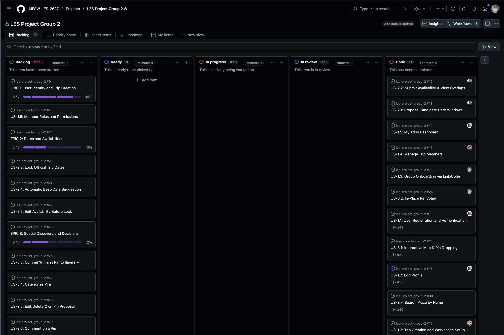

# CLAIM: Iteration 1

> **Group 2 — PlanIt!**
>
> **Increment / Milestone:** Iteration 1 — Collaborative Trip Workspaces, Candidate Date Windows and Member Availability, Pin Voting, Profile Customization, and Staging Infrastructure.
>


---

## Permalinks We Follow

| Item | Link | Notes |
| :--- | :--- | :--- |
| **This tag** | [`iter-1`](https://github.com/MESW-LES-2627/les-project-group-2/tree/iter-1) | Tag for Iteration 1 delivery; to be created |
| **Compare with the last tag** | [`iter-0...iter-1`](https://github.com/MESW-LES-2627/les-project-group-2/compare/iter-0...iter-1) | Comparison diff against Iteration 0; available once `iter-1` is created |
| **Production** | [https://planit2.vercel.app](https://planit2.vercel.app) | Live production deployment on Vercel (auto-deployed from `main`) |
| **Staging** | [https://planit2-staging.vercel.app](https://planit2-staging.vercel.app) | Live staging preview deployment on Vercel (auto-deployed from `staging`) with dedicated staging Supabase DB |
| **Pipeline** | [GitHub Actions Pipelines](https://github.com/MESW-LES-2627/les-project-group-2/actions) | [Checks workflow](https://github.com/MESW-LES-2627/les-project-group-2/blob/staging/.github/workflows/checks.yaml) & [Deploy workflow](https://github.com/MESW-LES-2627/les-project-group-2/blob/staging/.github/workflows/deploy.yml) |
| **MVP** | [Milestone 2: Minimum Viable Product (MVP)](https://github.com/MESW-LES-2627/les-project-group-2/milestone/2) | [Business Model & Features (Wiki)](https://github.com/MESW-LES-2627/les-project-group-2/wiki/Business-Model#features-and-assumptions) · [Epics & User Stories (Wiki)](https://github.com/MESW-LES-2627/les-project-group-2/wiki/Epics-and-User-Stories) |
| **Vision** | [Product Vision (Wiki)](https://github.com/MESW-LES-2627/les-project-group-2/wiki/Business-Model#product-vision) | Also documented in [README and Project Vision](https://github.com/MESW-LES-2627/les-project-group-2/blob/main/README.md#project-vision) |
| **Stories in this increment** | [Milestone 2: Minimum Viable Product (MVP)](https://github.com/MESW-LES-2627/les-project-group-2/milestone/2) | [Stories in this increment breakdown](#stories-in-this-increment) |
| **How to run the tests** | [Test & Setup instructions](#how-to-run-the-tests) | Also documented in [README and Local Development Setup](https://github.com/MESW-LES-2627/les-project-group-2/blob/main/README.md#local-development-setup) |
| **Retrospective** | [Retrospective](#retrospective) | What went well, what hurt, and proposed improvements |
| **AI log** | [AI log](#ai-log) | Log of AI toolchain interventions and caught discrepancies |
| **Team artefacts** | [Team artefacts](#team-artefacts) | Definition of Done, architecture configs, and workflows |

---

## Delivery

- **Verified staging snapshot:** [`25f936e9`](https://github.com/MESW-LES-2627/les-project-group-2/commit/25f936e9fcce096942fedfd5e29b280c1da36612), including PR #69 and its review fixes.
- **Tag:** [`iter-1`](https://github.com/MESW-LES-2627/les-project-group-2/tree/iter-1).
- **Compare with the last tag:** [`iter-0...iter-1`](https://github.com/MESW-LES-2627/les-project-group-2/compare/iter-0...iter-1).

## Environments

- **Production:** [https://planit2.vercel.app](https://planit2.vercel.app)
- **Staging:** [https://planit2-staging.vercel.app](https://planit2-staging.vercel.app)
- **Verified deployment status:** Staging includes the snapshot above; its [build, database migration, and Vercel deployment](https://github.com/MESW-LES-2627/les-project-group-2/actions/runs/42216262036) succeeded.
- **Pipelines:** [GitHub Actions](https://github.com/MESW-LES-2627/les-project-group-2/actions)
  - Lint and test validation: [`checks.yaml`](https://github.com/MESW-LES-2627/les-project-group-2/blob/staging/.github/workflows/checks.yaml); the deployment workflow runs the production build.
  - Automated deployment and database migrations: [`deploy.yml`](https://github.com/MESW-LES-2627/les-project-group-2/blob/staging/.github/workflows/deploy.yml) (Runs `supabase db push --yes` automatically on staging and production deploys).

## Product

- **Vision:** [Product Vision (Wiki)](https://github.com/MESW-LES-2627/les-project-group-2/wiki/Business-Model#product-vision) / [Project Vision (README)](https://github.com/MESW-LES-2627/les-project-group-2/blob/main/README.md#project-vision)
- **MVP:** [Milestone 2: Minimum Viable Product (MVP)](https://github.com/MESW-LES-2627/les-project-group-2/milestone/2)
  - Outlined in [Wiki Features and Assumptions](https://github.com/MESW-LES-2627/les-project-group-2/wiki/Business-Model#features-and-assumptions) and [Epics & User Stories](https://github.com/MESW-LES-2627/les-project-group-2/wiki/Epics-and-User-Stories).

---

## What Runs on This Tag

Building upon the Vertical Prototype delivered in Iteration 0, **Iteration 1** elevates PlanIt into a collaborative multi-user travel planning platform:

1. **Trip Creation & Workspace Management (US-1.2):**
   - Authenticated users can create trips with a name, destination, and description.
   - Automatic assignment of the creator as the trip organizer.
   - Dedicated trip workspace (`/trips/[id]`) with navigation sections for Dates, Map, Itinerary, and Expenses.
   - Server-side validation with informative error messages, trip detail updates, and trip deletion.

2. **Group Onboarding via Invite Link & Code (US-1.3):**
   - Trip organizers can generate, view, copy, and regenerate unique invite links and 6-character alphanumeric invite codes.
   - Regenerating the invite code immediately invalidates previous links and codes.
   - Seamless onboarding: Unauthenticated users visiting an invite link are redirected to sign up / log in with a `redirectTo` query parameter and automatically enrolled in the trip upon authentication.
   - Dedicated `/trips/join` form allowing logged-in members to input invite codes directly.

3. **In-Place Pin Voting & Date Scoping (US-3.2):**
   - Trip members can inspect proposed pins directly on the map, open the floating pin voting card, and vote or withdraw their vote.
   - Atomic idempotency enforced via a Postgres composite unique constraint `(pin_id, user_id, trip_date)`.
   - Vote count badges displayed directly on map markers with date-scoped voter lists.

4. **User Profile Customization (US-1.7):**
   - Users can update their display name (username) and upload custom avatar images.
   - Avatars are stored securely in Supabase Storage (`profile_pics` bucket) with public CDN resolution.
   - Dynamic profile modal accessible from the map header with real-time UI synchronization across the interface.

5. **Trip Membership Management (US-1.4):**
   - Members can view the trip's member list and roles; organizers can remove members.
   - Non-organizer members can leave a trip, while the organizer is prevented from leaving without first resolving ownership or deleting the trip.
   - Server-side checks and row-level security protect membership and trip access.

6. **My Trips Dashboard (US-1.5):**
   - Members can open the My Trips panel from the map, browse their trips and status/date information, and navigate to the trip workspace.
   - Includes loading, empty, and retry states, with schema support for trip state and trip dates.

7. **Candidate Date Windows (US-2.1):**
   - Organizers can propose, edit, and delete date windows; all trip members can view them.
   - Shared validation rejects invalid ranges and past start dates; PostgreSQL also enforces `end_date >= start_date`.
   - Organizer-only writes are enforced in server actions and RLS policies; a database trigger maintains `updated_at`.
   - Deletion requires confirmation, and add/save buttons display loading feedback.
   - Editing or deleting a window automatically removes answers outside every remaining candidate window, while preserving answers covered by overlapping windows.

8. **Submit Availability & View Overlaps (US-2.2):**
   - Members mark individual candidate days as available or unavailable; choosing "No answer" clears an existing answer.
   - Each day shows the available-member count and names, and the calendar lists members who have not answered any candidate day.
   - Server-side membership validation and RLS allow members to manage only their own answers inside candidate windows.
   - Availability queries fetch all pages instead of stopping at Supabase's 1000-row response limit, keeping overlaps and missing-member lists complete.
   - Calendar drafts reconcile refreshed dates and saved answers, dropping pruned answers without discarding unsaved edits to remaining days.

---

## Stories in This Increment

Tracked in [Milestone 2: Minimum Viable Product (MVP)](https://github.com/MESW-LES-2627/les-project-group-2/milestone/2):

### Merged Stories & Completed Infrastructure

| Story / Task | Issue | Pull Request | Status | Notes |
| :--- | :--- | :--- | :--- | :--- |
| **US-1.2: Trip Creation and Workspace Setup** | [#11](https://github.com/MESW-LES-2627/les-project-group-2/issues/11) | [PR #47](https://github.com/MESW-LES-2627/les-project-group-2/pull/47) | **Merged** | Trip creation form, validation, workspace routes (`/trips/[id]`), organizer assignment, workspace unit tests |
| **US-1.3: Group Onboarding via Link/Code** | [#12](https://github.com/MESW-LES-2627/les-project-group-2/issues/12) | [PR #59](https://github.com/MESW-LES-2627/les-project-group-2/pull/59) | **Merged** | Unique invite code generation, URL sharing, onboarding join action, auth redirect handling, acceptance tests |
| **US-1.4: Manage Trip Members** | [#13](https://github.com/MESW-LES-2627/les-project-group-2/issues/13) | [PR #63](https://github.com/MESW-LES-2627/les-project-group-2/pull/63) | **Merged** | Member lists, organizer-only removal, member leave action, access checks, and RLS policies |
| **US-1.5: My Trips Dashboard** | [#14](https://github.com/MESW-LES-2627/les-project-group-2/issues/14) | [PR #57](https://github.com/MESW-LES-2627/les-project-group-2/pull/57) | **Merged** | Map-side My Trips panel, workspace navigation, trip state/date schema, loading and error states |
| **US-1.7: Edit Profile** | [#16](https://github.com/MESW-LES-2627/les-project-group-2/issues/16) | [PR #56](https://github.com/MESW-LES-2627/les-project-group-2/pull/56) | **Merged** | Profile modal, username editing, avatar upload to Supabase storage, sync across map header, acceptance tests |
| **US-2.1: Propose Candidate Date Windows** | [#18](https://github.com/MESW-LES-2627/les-project-group-2/issues/18) | [PR #67](https://github.com/MESW-LES-2627/les-project-group-2/pull/67), [PR #69](https://github.com/MESW-LES-2627/les-project-group-2/pull/69) | **Merged; lock integration pending** | Organizer CRUD, member visibility, validation, RLS, timestamp trigger, deletion confirmation, and out-of-window availability pruning; lock-aware editing remains pending |
| **US-2.2: Submit Availability & View Overlaps** | [#19](https://github.com/MESW-LES-2627/les-project-group-2/issues/19) | [PR #69](https://github.com/MESW-LES-2627/les-project-group-2/pull/69) | **Merged** | Per-day answers, overlap counts/names, missing-member list, member-owned writes, paginated reads, draft reconciliation, and regression tests |
| **US-3.2: In-Place Pin Voting** | [#25](https://github.com/MESW-LES-2627/les-project-group-2/issues/25) | [PR #60](https://github.com/MESW-LES-2627/les-project-group-2/pull/60) | **Merged** | In-place map voting card, atomic idempotency constraint, date scoping, voters list, acceptance tests |

---

## How to Run the Tests

Documented in [README and Local Development Setup](https://github.com/MESW-LES-2627/les-project-group-2/blob/main/README.md#local-development-setup).

Execute tests and verify coverage with:

```bash
# Run all unit and acceptance tests with coverage report
npm test

# Run only unit tests
npm run test:unit

# Run only acceptance tests
npm run test:acceptance

# Run linting check
npm run lint

# Run production build
npm run build

# With Docker running: start local Supabase and apply pending migrations
npm run db:start
npx supabase migration up --local

# Run PostgreSQL date-window constraint, RLS, and timestamp-trigger tests
npx supabase test db
```

---

## Team Artefacts

| Artefact | Link | Notes |
| :--- | :--- | :--- |
| **Definition of Done** | [Wiki: Definition of Done](https://github.com/MESW-LES-2627/les-project-group-2/wiki/Business-Model#definition-of-done) | Explicit quality gates (>90% line coverage, zero compile/lint errors, PR approval, Doxygen comments, acceptance tests) |
| **Product Vision & Business Model** | [Wiki: Business Model](https://github.com/MESW-LES-2627/les-project-group-2/wiki/Business-Model) | Problem, solution, features, and core project assumptions |
| **Epics and User Stories** | [Wiki: Epics and User Stories](https://github.com/MESW-LES-2627/les-project-group-2/wiki/Epics-and-User-Stories) | Breakdown of all 6 project epics and associated stories |
| **Database Migrations** | [`supabase/migrations/`](https://github.com/MESW-LES-2627/les-project-group-2/tree/staging/supabase/migrations) | Versioned SQL migrations for trips, memberships, profiles/storage, pins/votes, trip dates/state, candidate windows, and member availability with pruning |
| **CI/CD Quality & Deployment Workflows** | [`.github/workflows/checks.yaml`](https://github.com/MESW-LES-2627/les-project-group-2/blob/staging/.github/workflows/checks.yaml) · [`.github/workflows/deploy.yml`](https://github.com/MESW-LES-2627/les-project-group-2/blob/staging/.github/workflows/deploy.yml) | Automated pull request validation, automated Supabase DB push, and Vercel deployments |

---

## Retrospective

### What went well

- **Automated Continuous Delivery & Migrations:** Implemented automated Supabase database migrations on deploy, completely eliminating manual schema updates on staging and production.
- **Environment Isolation:** Provisioned a dedicated Supabase Staging project, ensuring testing and CI deployments never touch or pollute production database records.
- **Thorough Acceptance & Unit Testing:** The current snapshot passes 301 application tests with 94.6% line coverage, plus 12 committed local database regression tests and the temporary SQL review checks described above.
- **Robust Group Onboarding:** Implemented a full invite link and 6-character code mechanism with login redirects and duplicate-join guards.
- **Profile Integration:** Successfully integrated Supabase Storage with image uploads, dynamic avatars, and synchronized header display.

### What could be done better

- **Coordination on Database Schema:** Multiple PRs created overlapping and conflicting migrations (e.g. duplicate timestamp `20261105120000`, conflicting foreign key definitions, and unmigrated table assumptions). Early alignment on migrations before writing backend queries will avoid rework.

---

## AI Log

### Code generation & Architecture
Used Gemini 3.8 Flash with Antigravity CLI.

- CI/CD Migration Automation
- Schema & Storage Provisioning
- Review & Discrepancy Detection

### Final Board:

<br>


