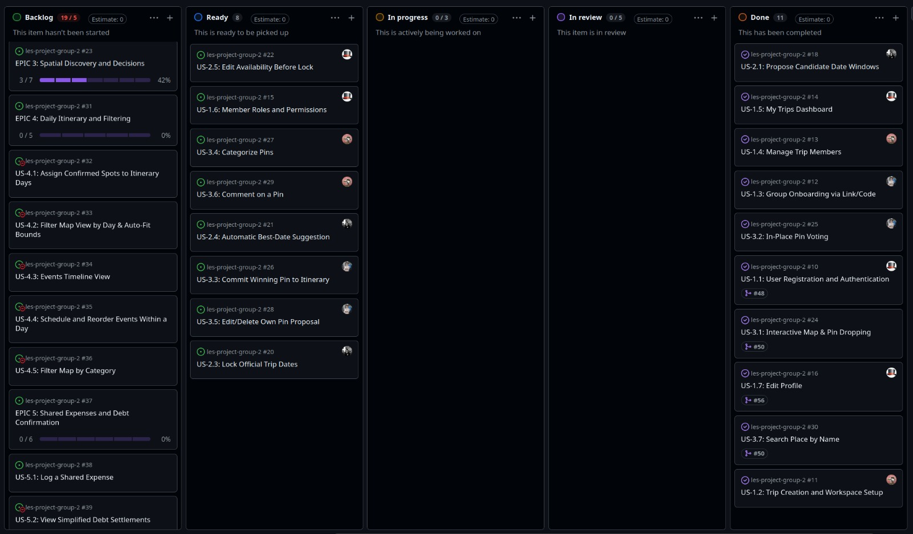

# Retrospective

## Board at the Start of the Iteration

The board before the six delivered stories moved to Done. It is the state this
retrospective refers to when discussing the two Ready stories that were not
delivered.

## What went well

- **Both decision loops are complete.** Candidate windows (US-2.1) and
  availability (US-2.2) from Iteration 1 feed ranked suggestions (US-2.4), an
  official locked range (US-2.3) and one itinerary day per day. Proposed pins
  (US-3.1/3.2) now become confirmed spots (US-3.3) and can be corrected or
  withdrawn by their authors (US-3.5).
- **The group can change its mind safely.** Organizer transfer (US-1.6) is an
  atomic database operation that demotes the old organizer and promotes the new
  one in the same transaction, with the application layer repeating the
  authorization checks. Pin confirmation and reverting remain reversible.
- **Decisions are enforced, not just displayed.** Locking is a `security definer`
  database function with RLS freezing availability and candidate windows while
  locked. Pin confirmation, pin editing and organizer transfer each have a
  database-level guard in addition to the server-action checks.
- **Regression safety grew substantially.** The suite now has 563 passing tests
  across 84 files: 512 Vitest tests and 51 Playwright browser tests covering
  every merged story. Line coverage is 90.49%, lint is clean (0 errors, 0
  warnings) and the production build passes.
- **The acceptance tests now exercise the real application.** PR #75 replaced
  the component-only acceptance tests with Playwright tests that drive Chromium
  through the actual pages, with deterministic in-memory data and no seeded
  database.
- **Delivery stayed automated and is now guarded.** The staging pipeline built
  the application, applied migrations and deployed every merge in this
  increment; the final snapshot passed both Checks and Deploy. PR #78 added
  `Migration Guard`, `Database` and `Build` jobs, so an edited migration, an
  invalid clean rebuild, or a compile/type error now fails before merge.
- **Review caught two high-risk problems before they shipped.** The Playwright
  test-session cookie was originally honoured in every environment (an
  authentication bypass) and the acceptance branch broke `next build` while CI
  stayed green. Both were fixed before merge.

## What could be done better

- **A merged PR can still miss the integration branch.** PR #74 (US-3.5) was
  merged into `feature/US-3.3` after #73 had already merged that branch to
  `staging`, so GitHub showed US-3.5 as merged while none of its code was on
  staging. PR #81 re-targeted the same commit to `staging` and fixed it. Child
  PRs must be merged before their parent branch, and the base branch must be
  checked before merging.
- **CI did not run the production build until the close-out.** PR #80 passed
  lint and tests while `next build` failed on a type error, and the acceptance
  branch failed on unadapted test specs. PR #78 added a `Build` job; the gate is
  now in place, but the gap existed for most of the increment.
- **Migration ordering needed an escape hatch until the close-out.**
  `20261107000000_add_pin_confirmation.sql` reached `staging` after
  `20261109100000_lock_trip_dates.sql`, so the deploy relied on
  `supabase db push --include-all`. PR #78 now rejects this at review time and
  rebuilds a clean database before merge.
- **Already-applied migrations must not be edited.** An open branch changed a
  migration that is already on staging. The correct fix is always a new
  migration; the guard in PR #78 enforces it.
- **Long-lived PRs accumulate conflicts and stale checks.** PR #78 was opened on
  19 November and needed a staging merge plus a second check run on 20 November
  before it was mergeable, and its docs page had to be removed to keep the PR
  focused. Shorter-lived branches and a rebase/merge cadence would avoid this.
- **Two Ready stories were assigned but not delivered.** US-3.4 (Categorize
  Pins) and US-3.6 (Comment on a Pin) both had an assignee and sat in the Ready
  column, but no implementation or pull request was produced. The board status
  was mistaken for progress: a Ready card needs a mid-iteration check, and an
  assigned card with no PR should be escalated or reassigned before the
  increment closes. Both are carried into Iteration 3 and need an explicit
  owner before work starts.
- **Coverage margin is thin.** Line coverage dropped from 93.96% to 90.49% as
  the map and role-management surfaces grew. `TripMapContainer` and
  `LeafletMap` remain the weakest files, especially marker interactions and
  persistence-error paths.
- **Manual database verification was postponed.** The automated acceptance
  tests use the in-memory Supabase client, so they do not exercise real RLS
  policies. One end-to-end pass against the Docker stack should be part of the
  release checklist.

## Proposed Improvements

1. Enable `Migration Guard`, `Database`, `Build`, `Lint and Format` and `Test`
   as required checks on `staging` and `main` before starting Iteration 3.
2. Enforce child-before-parent merge order and make the base branch part of the
   PR checklist; never merge a story into another feature branch after that
   branch has reached `staging`.
3. Add a release checklist item for a manual pass on the local Supabase stack,
   covering lock/unlock, pin confirmation/edit/delete and organizer transfer
   against real RLS policies.
4. Keep the coverage gate above 90% and add focused browser or component tests
   for map marker interactions and persistence-error paths next iteration.
5. Freeze story merges at least two days before the iteration tag so the
   increment can be reviewed and deployed as a whole.
6. Reassign and deliver the two Ready stories carried over from this claim
   (US-3.4 Categorize Pins and US-3.6 Comment on a Pin) in Iteration 3, with a
   mid-iteration check that every assigned Ready card has a PR.
